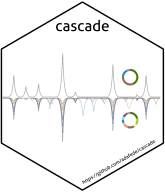
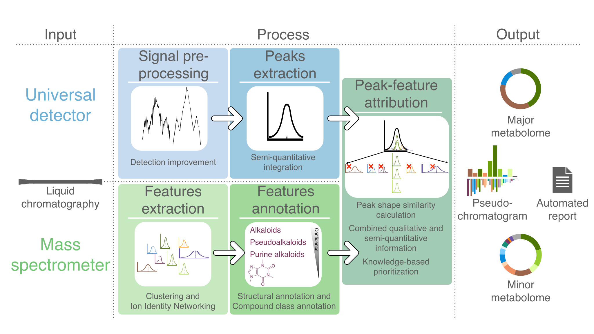

---
format:
  gfm: default
---

<!-- README.md is generated from README.qmd. Please edit README.qmd and render with quarto. -->

# CASCADE 

<!-- badges: start -->
[](https://lifecycle.r-lib.org/articles/stages.html#experimental)
[](https://github.com/adafede/cascade/actions/workflows/R-CMD-check.yaml)
[](https://app.codecov.io/gh/adafede/cascade)
[](https://adafede.r-universe.dev/cascade)
[](https://doi.org/10.5281/zenodo.14515158)
<!-- badges: end -->

**C**ontextualizing untargeted **A**nnotation with **S**emi-quantitative
**C**harged **A**erosol **D**etection for pertinent characterization of natural
**E**xtracts.

`cascade` is an R package for analyzing natural-product extracts by linking
untargeted LC-HRMS/MS feature tables and taxonomically informed metabolite
annotations with semi-quantitative universal detectors (CAD, PDA, ELSD). It
provides Fourier low-pass filtering, derivative-based peak sharpening,
exponential-Gaussian hybrid (EGH) peak fitting, trapezoidal integration, MS1
extracted ion chromatogram correlation, LOTUS/Wikidata chemotaxonomic summaries,
and interactive plots.

The original method is described at <https://doi.org/10.1021/acs.jafc.3c03099>.



## Input Requirements

To process your own extracts you need:

- An [.mzML](https://en.wikipedia.org/wiki/Mass_spectrometry_data_format#mzML)
  file containing MS1 data along with at least one auxiliary chromatographic
  detector trace ([PDA](https://en.wikipedia.org/wiki/UV_detectors),
  [ELSD](https://en.wikipedia.org/wiki/Evaporative_light_scattering_detector),
  or [CAD](https://en.wikipedia.org/wiki/Charged_aerosol_detector)). See
  [wiki/How-to-create-a-compliant-mzML-file](https://github.com/adafede/cascade/wiki/How-to-create-a-compliant-mzML-file).
- A [.csv](https://en.wikipedia.org/wiki/Comma-separated_values) feature table
  exported from [mzmine](https://mzio.io).
- A [.tsv](https://en.wikipedia.org/wiki/Tab-separated_values) annotation table
  from [TIMA](https://taxonomicallyinformedannotation.github.io/tima/).

## Installation

`cascade` is not on CRAN. Requires R (>= 4.5.0) and NetCDF system libraries for
`mzR` (`brew install netcdf` on macOS; `libnetcdf-dev` on Debian/Ubuntu).

Install from source on GitHub:

```r
# Using pak
pak::pak("adafede/cascade")

# Or using remotes
remotes::install_github("adafede/cascade")
```

Or install prebuilt binaries when available via r-universe:

```r
install.packages(
  "cascade",
  repos = c(
    "https://adafede.r-universe.dev",
    "https://cran.r-universe.dev",
    "https://bioc.r-universe.dev"
  )
)
```

Because the package bundles roughly 45 MB of `bzip2`-compressed example datasets
under `data/`, initial source installation takes several minutes.

## Quickstart

All bundled examples use *Swertia chirayita* LC-CAD-HRMS/MS data and run offline
with `show_example = TRUE`:

```r
library(cascade)

# Inspect detector retention-time alignment and peak integration
check_chromatograms_alignment(show_example = TRUE)
check_peaks_integration(show_example = TRUE)

# Integrate detector peaks and correlate with MS1 extracted ion chromatograms
peaks <- process_compare_peaks(show_example = TRUE)

# Build interactive pseudochromatograms and treemaps from TIMA annotations
plots <- generate_pseudochromatograms(show_example = TRUE)

# Visualize standalone TIMA annotation outputs
prepare_tima_annotations(show_example = TRUE) |>
  plot_tima()
```

Further step-by-step examples are available in the
[articles](https://adafede.github.io/cascade/articles/).

## Scope and Limitations

- **Network-dependent functions**: `generate_ids()` queries the live Wikidata
  SPARQL endpoint (`query.wikidata.org`, falling back to QLever), and
  `generate_tables()` downloads the LOTUS snapshot archive from Zenodo on first
  run unless already cached under `tools::R_user_dir("cascade", "cache")`.
- **Detector assumptions**: `process_compare_peaks()` correlates MS1 XICs
  against a chosen trace (`"CAD"`, `"PDA"`, or `"ELSD"`); trace quality and
  retention-time offset (`cad_shift`, `pda_shift`, or `"auto"`) affect
  feature-to-peak matching.
- **Bundled data coverage**: Built-in examples illustrate *Swertia chirayita*
  positive- and negative-mode extracts; external files must follow mzmine CSV
  and TIMA TSV column schemas.

## Citations and Dependencies

To cite `cascade` in publications, run `citation("cascade")`:

- CASCADE: <https://doi.org/10.1021/acs.jafc.3c03099>

Depending on the steps in your workflow, please also cite the upstream tools and
resources used:

- mzmine: <https://doi.org/10.1038/s41587-023-01690-2>
- SIRIUS (<https://doi.org/10.1038/s41592-019-0344-8>), CSI:FingerId
  (<https://doi.org/10.1073/pnas.1509788112>), ZODIAC
  (<https://doi.org/10.1038/s42256-020-00234-6>), CANOPUS
  (<https://doi.org/10.1038/s41587-020-0740-8>), COSMIC
  (<https://doi.org/10.1038/s41587-021-01045-9>)
- LOTUS (<https://doi.org/10.7554/eLife.70780>); note the snapshot DOI you used:
  <https://doi.org/10.5281/zenodo.5794106>
- ISDB (<https://doi.org/10.1021/acs.analchem.5b04804>); note the version DOI
  you used: <https://doi.org/10.5281/zenodo.5607185>
- TIMA (<https://doi.org/10.3389/fpls.2019.01329>); note the version DOI you
  used: <https://doi.org/10.5281/zenodo.5797920>
- NPClassifier: <https://doi.org/10.1021/acs.jnatprod.1c00399>

Core R package dependencies declared in `DESCRIPTION`: `baseline`, `curl`,
`data.table`, `ggplot2`, `gt`, `mzR`, and `plotly`.
